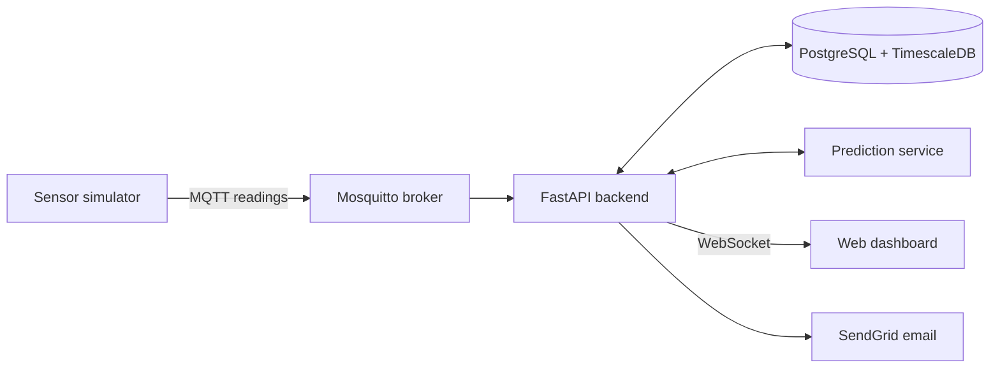

# SRS

## Smart Cold Storage Monitor

**Team:** [Team Name / Number]

### Team Members

* Zi Ye
* Leyang Pan
* Bo Sun

---

## Problem Statement

Cold storage for perishable food and temperature-sensitive drugs such as vaccines and biologics fails in predictable ways: door seals wear out, compressors weaken, doors are left open, and power goes out. Most monitoring systems either depend on staff checking thermometers on a schedule or sound an alarm once the temperature has already crossed the safe limit. By then the stock is often lost. Facilities also need records that show inspectors what happened, who responded, and what was fixed, and in many existing systems anyone with database access can quietly edit those records.

---

## Objective

Build a web-based monitoring system that tracks the temperature of every storage unit in a facility, warns staff before a unit leaves its safe range, and keeps a tamper-evident record of every alarm and response.

The project has two goals beyond a basic threshold alarm:

1. **Early warning.** The system watches how hard each unit's compressor is working and how its temperature is trending, and warns staff before the temperature leaves the safe range.
2. **Trustworthy records.** Every important event goes into an append-only audit log in which each record carries the hash of the record before it, so any edit or deletion can be detected. The log implements selected audit controls from NIST SP 800-53 Rev. 5 (AU-2, AU-3, AU-6, AU-9) and follows the audit trail expectations of FDA 21 CFR Part 11.

---

## Approach: Simulated Sensors

This project uses no physical hardware. A software simulator plays the role of the facility's freezers and sensors and sends readings in the same format a real sensor gateway would. Everything after the message broker works the same way with real sensors, so connecting physical hardware later needs no changes to the backend, prediction service, or dashboard.

The simulator also gives the project something real hardware cannot. For every fault it creates, it records exactly when the fault started and when the temperature left the safe range. These records are the ground truth used to train and grade the prediction models.

---

## Primary Use Case

**Users:** Facility operator, maintenance technician, quality assurance (QA) auditor

1. Temperature, humidity, and door sensors inside a frozen vaccine freezer (safe range -50°C to -15°C) report readings every 10 seconds over MQTT. In this project, the simulator generates these readings.
2. Every minute, the prediction service reviews the last few hours of data for the freezer. It notices that the compressor runs longer each cycle and that the coldest point of each cycle is creeping upward, while the temperature is still inside the safe range.
3. The service estimates that the freezer will rise above -15°C in about three hours and marks it as high risk.
4. The dashboard shows the freezer as at risk, and the on-duty technician receives an email alert.
5. The audit log records the alert with its time, unit, risk estimate, safe range, and recipient.
6. The technician acknowledges the alert, finds a worn door gasket, replaces it, and enters the corrective action in the dashboard. Each step is added to the audit log.
7. The QA auditor opens the incident timeline, runs the log integrity check, and exports the records for the facility's compliance file.

---

## Scope

### Must have

* Sensor simulator with normal operation and five fault scenarios
* Telemetry ingestion and storage
* Live overview dashboard and unit detail page
* Threshold, sensor-offline, sensor-suspect, and predictive alerts on the dashboard and by email, with escalation
* Prediction service with three model tiers and an evaluation report
* Tamper-evident audit log with integrity check, explorer, and CSV/JSON export
* Role-based access control (RBAC) with four roles
* Storage profiles and unit configuration
* Deployment with Docker Compose on one AWS EC2 instance

### Stretch goals

* SMS alerts through Twilio
* PDF incident report export
* Multi-factor sign-in for auditors and administrators
* Daily copy of the latest audit hash to write-once cloud storage (AWS S3 Object Lock)
* "Inject fault" button on the admin page for demos

---

## Assumptions and Out of Scope

* All sensor data comes from the simulator. Physical sensors, gateways, and firmware are out of scope.
* The simulator uses a simplified thermal model with parameters drawn from published freezer specifications. It is not calibrated to any specific freezer model.
* Prediction accuracy is measured on simulated data only. Testing on real freezer data is future work.
* The system serves a single facility.
* Implementing selected NIST SP 800-53 controls and following Part 11 audit trail expectations does not make the system certified or validated for regulated use.

---

## Tech Stack

| Layer | Choice |
|---|---|
| Frontend | React with TypeScript, Tailwind CSS, shadcn/ui, Zustand (state), Recharts (charts) |
| Backend | Python FastAPI; REST API plus WebSockets for live updates |
| Authentication | OAuth 2.0 password flow with JWT access tokens; Argon2 password hashing |
| Database | PostgreSQL with the TimescaleDB extension, one database for readings, users, units, alerts, and the audit log |
| Message broker | Eclipse Mosquitto (MQTT) over TLS |
| Sensor simulator | Python with paho-mqtt; scenarios defined in YAML files |
| Prediction | Python with pandas, scikit-learn, and XGBoost, served as a separate FastAPI service |
| Notifications | SendGrid (email); Twilio (SMS, stretch) |
| Testing | Pytest, Vitest with React Testing Library, Locust |
| Development | Git and GitHub, GitHub Actions, Docker Compose, Jira and Confluence |
| Hosting | AWS EC2; Nginx reverse proxy with TLS |

---

## System Overview



1. **Sensor simulator** generates readings for every simulated unit and publishes them to the broker.
2. **Message broker (Mosquitto)** passes each reading to every backend service that subscribes to it. It does not store readings.
3. **Backend (FastAPI)** receives readings, stores them, checks them against each unit's safe range, runs alert logic, writes audit records, serves the REST API, and pushes live updates to the dashboard.
4. **Database (PostgreSQL + TimescaleDB)** keeps the full reading history along with users, units, profiles, alerts, and the audit log.
5. **Prediction service** reads recent history for each unit and returns a risk level and an estimated time until the unit leaves its safe range.
6. **Web dashboard** shows live status to operators and technicians and gives auditors the audit log explorer.

---

## Sensor Simulator

Each simulated unit has a set point, a safe range, a compressor, scheduled defrost cycles, and random door openings. The compressor switches on when the temperature reaches the top of its control band and off when it reaches the bottom, which produces the sawtooth temperature pattern of a real freezer.

Most faults change how the compressor behaves before they change the temperature. The simulator models the following scenarios:

* **Door gasket leak:** warm air leaks in, so the temperature rises faster while the compressor is off, and the compressor runs longer and more often. The temperature stays in range until the compressor can no longer keep up.
* **Compressor wear:** the unit cools more slowly, so each compressor run gets longer and the unit takes longer to recover after a door opening.
* **Compressor failure:** the compressor stops and the temperature rises steadily.
* **Power outage:** every unit at the facility warms up at the same time.
* **Sensor faults:** a sensor stops reporting, repeats the same value, or sends noisy readings.

Faults can be started on demand from a command-line tool or on a schedule defined in a scenario file. Every run uses a fixed random seed, so any scenario can be replayed exactly. For each fault, the simulator logs when the fault started and when the temperature left the safe range. A speed setting (for example, 60x) lets a six-hour failure play out in six minutes for demos and tests.

Each reading is published to the topic `facility/{unit_id}/telemetry` as JSON:

```json
{
  "unit_id": "F-03",
  "timestamp": "2026-10-08T17:00:10Z",
  "seq": 18342,
  "temperature_c": -21.3,
  "humidity_pct": 40.2,
  "door_open": false
}
```

The sequence number `seq` lets the backend detect missing, repeated, or out-of-order readings.

---

## Prediction Approach

The hard part of prediction is telling a normal temperature rise that will reverse on its own (a compressor off-cycle, a defrost, a door opening) apart from a rise caused by a fault. A straight-line forecast on raw temperature would flag every compressor off-cycle. Early signs of most faults also show up in compressor behavior before the temperature itself drifts.

There is no compressor sensor. The service detects compressor runs from the falling segments of the temperature curve and computes these features for each unit every minute:

* temperature averaged over the last full compressor cycle, and its trend over the last few hours
* compressor duty cycle, the share of each hour the unit spends cooling
* length of each cooling run and each warming segment
* time to recover after a door opening or defrost
* number of door openings and total open time in the last hour

Three tiers are built and evaluated on the same held-out set of simulated runs:

1. **Baseline:** straight-line extrapolation of raw temperature over the last 30 minutes.
2. **Cycle-aware rules:** straight-line extrapolation of the cycle-averaged temperature, combined with rules on duty cycle and recovery time.
3. **XGBoost model:** trained on the features above to predict whether the unit will leave its safe range within the next 4 hours and how soon.

Evaluation metrics:

* **Detection rate:** share of injected faults that receive a warning before the temperature leaves the safe range
* **Lead time:** time from the first warning to the actual excursion, reported as the median and the 10th percentile
* **False alarms:** alerts per unit per week of simulated normal operation

Targets for the tier the system uses: detection rate of at least 90%, median lead time of at least 60 minutes, and no more than 1 false alarm per unit per week. The system uses the tier with the highest detection rate that meets the false alarm target, and the report includes results for all three tiers.

---

## External Interface Requirements

### User Interfaces

* **Overview dashboard:** every unit with its current temperature, status (Normal, At risk, Excursion, Offline, Sensor suspect), and banners for active alerts. Each status is shown with both a color and a text label.
* **Unit detail page:** the last 24 hours of temperature with the safe range band and door openings marked, the predicted temperature for the next 4 hours, and the current risk estimate.
* **Alerts page:** open and past alerts, an acknowledge button, and a corrective action form.
* **Audit log explorer:** filters by event type, user, time range, unit, and NIST control ID; an integrity check button; CSV and JSON export.
* **Profiles and units page:** storage profiles, safe ranges, and simulated unit settings.
* **Users and settings page:** user accounts, roles, alert recipients, and escalation contacts.

### Hardware Interfaces

* **Client devices:** desktop, tablet, and mobile web browsers. The system needs no physical sensors or gateways.

### Software Interfaces

* **MQTT:** the simulator publishes JSON readings to `facility/{unit_id}/telemetry` over TLS.
* **Prediction service API:** an internal REST endpoint that takes a unit ID and time window and returns a risk level, estimated time to excursion, and confidence.
* **Email:** SendGrid API.
* **SMS (stretch):** Twilio API.

---

## Functional Requirements

Each requirement is marked **Must** or **Stretch**. Requirements tied to a NIST control list the control ID.

### Simulator

* **FR-1 (Must):** The simulator runs at least 50 units at once, each reporting at a configurable interval between 5 and 60 seconds.
* **FR-2 (Must):** A team member can start any fault scenario on any unit from a command-line tool.
* **FR-3 (Must):** The simulator writes a ground-truth log of each fault's start time and excursion time.
* **FR-4 (Must):** While the broker is unreachable, the simulator buffers readings and resends them in order once the connection returns.

### Ingestion and Monitoring

* **FR-5 (Must):** The backend stores every reading with its unit ID, UTC timestamp, and sequence number, and drops duplicate readings.
* **FR-6 (Must):** The backend marks a unit as Excursion and raises an alert when a reading falls outside the unit's safe range.
* **FR-7 (Must):** The backend raises an Offline alert when a unit misses 3 consecutive reporting intervals.
  *Test:* stop one simulated unit. The alert appears within 10 seconds of the third missed interval.
* **FR-8 (Must):** The backend raises a Sensor suspect alert when a unit reports the same value for 10 minutes, or when two consecutive readings differ by more than a configurable limit (default 10°C).

### Prediction

* **FR-9 (Must):** Every 60 seconds, the prediction service returns a risk level (Low, Medium, High), an estimated time to excursion, and a confidence score for each unit.
* **FR-10 (Must):** The team evaluates all three prediction tiers on the same held-out simulated runs and keeps the results in the repository.

### Alerts

* **FR-11 (Must):** The system raises a predictive alert when a unit stays at High risk for 3 consecutive prediction runs. This filters out short spikes from door openings and defrost cycles.
* **FR-12 (Must):** Every alert appears on the dashboard and is emailed to the on-duty technician within 30 seconds.
* **FR-13 (Must):** An alert that no one acknowledges within 15 minutes (configurable) is escalated to the supervisor.
* **FR-14 (Must):** While an alert for a unit is open, the system sends no repeat alerts for the same cause.
* **FR-15 (Must):** A technician acknowledges an alert and closes it with a corrective action note.
* **FR-16 (Stretch):** Alerts are also sent by SMS through Twilio.

### Audit Log

* **FR-17 (Must, AU-2):** The system logs these events: sign-in success and failure; sign-out; changes to safe ranges, profiles, units, users, and roles; alerts created, sent, acknowledged, escalated, and closed; corrective actions; integrity checks and exports; and system errors.
* **FR-18 (Must, AU-3):** Each audit record contains the UTC time, the user or service that acted, the event type, the outcome, the affected unit or record, event details, the related NIST control ID, the hash of the previous record, and its own SHA-256 hash.
* **FR-19 (Must, AU-9):** The application's database account can only insert and read audit records. No application feature can edit or delete them.
* **FR-20 (Must, AU-9):** An auditor can run an integrity check that recomputes the hash chain and reports the first record that does not match.
  *Test:* edit one audit record directly as the database superuser. The check flags that record.
* **FR-21 (Must, AU-6):** The audit log explorer filters records and exports them as CSV and JSON.
* **FR-22 (Stretch):** The system exports a PDF incident report for a selected alert.
* **FR-23 (Stretch, AU-9):** Once a day, the system copies the latest audit hash to an AWS S3 bucket with Object Lock. A database administrator who rewrites the whole chain cannot change these copies, so the rewrite is still detected.

### Access Control

* **FR-24 (Must):** The system has four roles with these permissions:

| Action | Operator | Technician | Auditor | Admin |
|---|---|---|---|---|
| View dashboard, units, and alerts | ✓ | ✓ | ✓ | ✓ |
| Acknowledge alerts | ✓ | ✓ | | |
| Record corrective actions | | ✓ | | |
| View, check, and export the audit log | | | ✓ | |
| Manage users, roles, profiles, units, and alert settings | | | | ✓ |

* **FR-25 (Must):** Users cannot change their own role.
* **FR-26 (Stretch):** Auditors and admins sign in with a second factor from an authenticator app.

### Profiles and Units

* **FR-27 (Must):** Admins create and edit storage profiles. The system ships with these default profiles:

| Profile | Default safe range |
|---|---|
| Frozen vaccines | -50°C to -15°C |
| Refrigerated vaccines | 2°C to 8°C |
| Ultra-low biologics | -90°C to -70°C |
| Refrigerated food | 0°C to 5°C |

* **FR-28 (Must):** Admins register simulated units, assign each one a profile, and set its reporting interval and calibration offset.

---

## Non-Functional Requirements

* **NFR-1 Latency:** With 50 units reporting every 5 seconds, 95% of readings appear on the dashboard within 2 seconds of being sent.
* **NFR-2 Prediction speed:** Each prediction run for all 50 units finishes within 5 seconds.
* **NFR-3 Load:** The system handles 200 units reporting every 5 seconds for one hour with no lost or duplicated readings. Tested with the simulator and Locust.
* **NFR-4 Recovery:** Restarting the backend during a run loses no readings. Tested by restarting the backend container and comparing sequence numbers.
* **NFR-5 Security:** All browser and MQTT connections use TLS. Passwords are hashed with Argon2. Access tokens expire after 30 minutes. Database storage on AWS uses AES-256 encrypted volumes. Secrets are kept in environment variables and never committed to the repository.
* **NFR-6 Usability:** In user acceptance testing, at least 3 people who have not used the system find the at-risk unit and acknowledge its alert within 60 seconds without help. Every page works on screens 375 px wide and larger.
* **NFR-7 Prediction quality:** The tier the system uses meets the targets in the Prediction Approach section.

---

## Estimated Timeline (10 weeks)

Unit tests are written alongside each feature from Week 3 onward and run on every push through GitHub Actions.

### Week 1–2: Planning, design, and simulator

* Set up the GitHub repository, CI, Jira, and Confluence.
* Finalize the architecture, database schema, and MQTT message format.
* Map each NIST AU control to the features that implement it.
* Build simulator version 1 with normal operation and the door gasket leak scenario.
* Create dashboard wireframes.

### Week 3–4: Core system

* Build sign-in, roles, and permissions.
* Build ingestion from Mosquitto through the backend into TimescaleDB.
* Build the overview dashboard and unit detail page with live updates.
* Add threshold and offline alerts on the dashboard.
* Build the hash-chained audit log, starting with sign-in and settings events.

### Week 5–6: Prediction and alerts

* Add the remaining fault scenarios and generate labeled training and test runs.
* Build prediction tiers 1 and 2 and connect the prediction service to the backend.
* Add predictive alerts, email delivery, escalation, and duplicate suppression.

### Week 7: Model and audit features

* Train and evaluate prediction tier 3 (XGBoost).
* Build the audit log explorer, integrity check, and CSV/JSON export.
* Build storage profiles, unit configuration, and the corrective action workflow.

### Week 8: Testing

* Run end-to-end and integration tests.
* Run load and recovery tests.
* Write the model evaluation report comparing all three tiers.
* Run the audit log tamper test.

### Week 9: User acceptance testing and fixes

* Run user acceptance testing with at least 3 people.
* Fix bugs, polish the UI, and work on stretch goals.

### Week 10: Deployment and documentation

* Deploy with Docker Compose on AWS EC2 behind Nginx.
* Write the API reference, NIST control mapping, and operator guide.
* Record the demo and prepare the final presentation.
